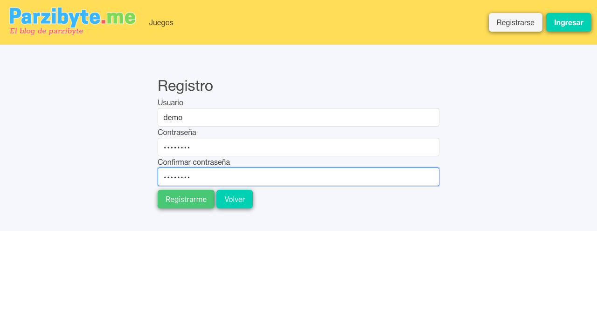
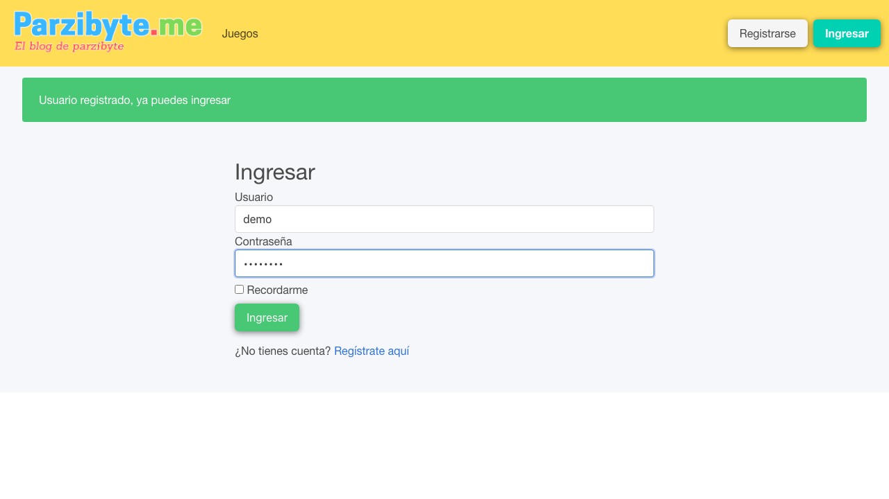
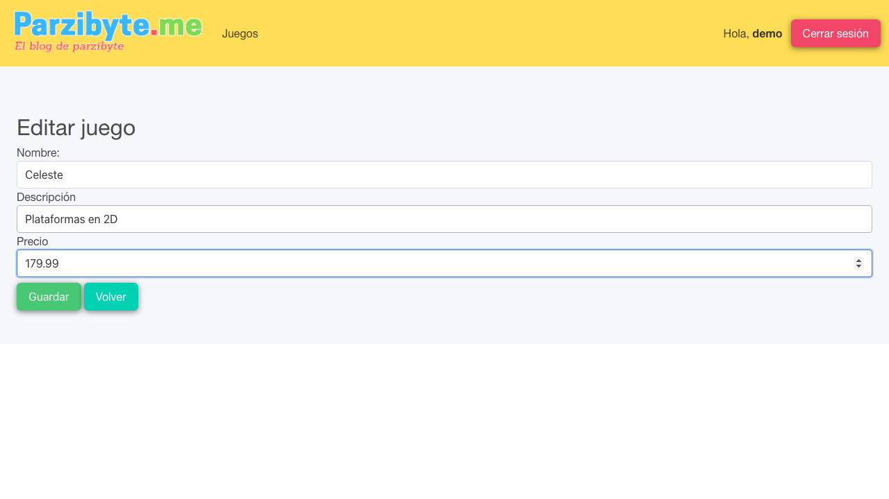
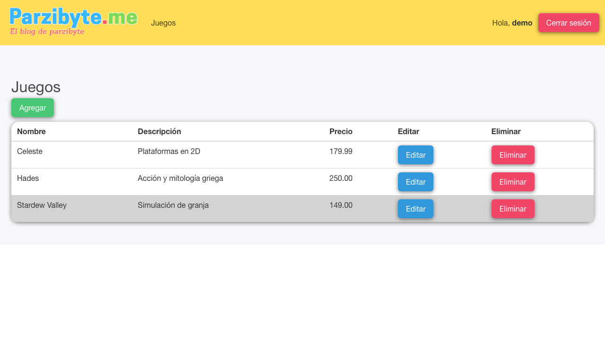

U4 - A4 Despliegue de Producción del Mini-Sistema de Videojuegos

App de videojuegos en Flask con login. Corre en Docker con Gunicorn y MySQL.

Pasos para levantar la aplicación

Abrir Docker Desktop, clonar el repositorio, entrar a la carpeta y correr: docker compose up --build -d

Después entrar a http://localhost, registrarse e iniciar sesión.

Variables de entorno

Están en docker-compose.yml. DATABASE_URL es la conexión a MySQL y SECRET_KEY es la clave de las sesiones. MYSQL_ROOT_PASSWORD, MYSQL_DATABASE, MYSQL_USER y MYSQL_PASSWORD son los datos de la base de datos.

Comandos usados

Para levantar la app: docker compose up --build -d

Para ver los contenedores: docker compose ps

Para ver los mensajes de la app: docker compose logs web

Para apagar la app: docker compose down

Capturas de pantalla

Registro

Login

Agregar juego

Editar juego

Lista de juegos

